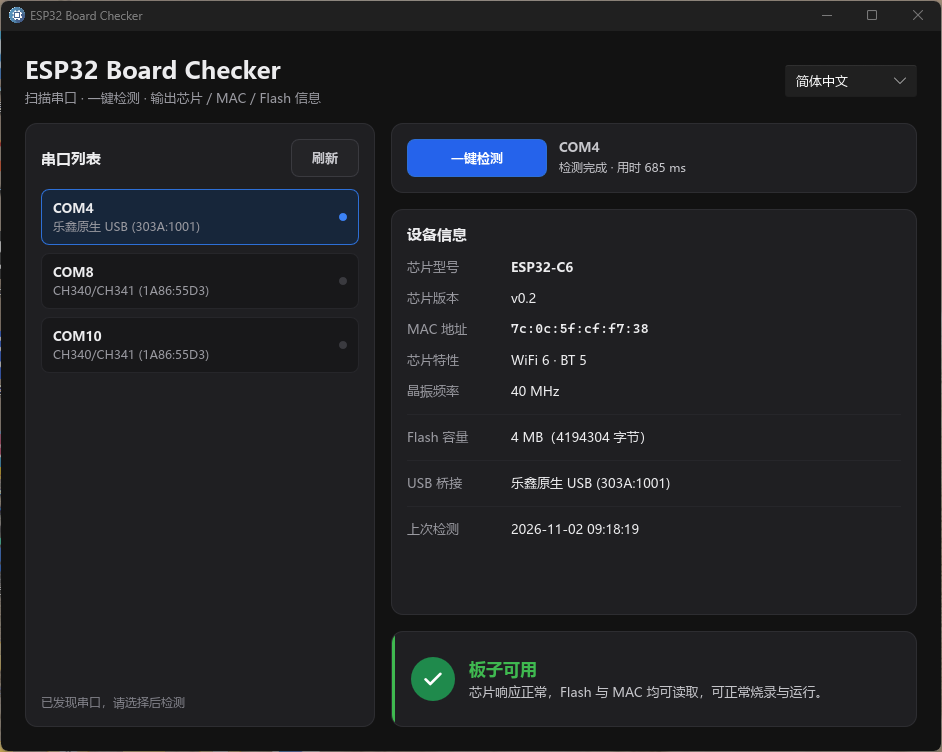

# ESP32 Board Checker

一个用 Rust + [Slint](https://slint.dev/) 编写的桌面小工具，用于扫描串口、识别连接的 ESP32 系列芯片，并判断板子是否可正常烧录与使用。



## 功能

- **串口扫描**：自动枚举系统所有串口，识别桥接芯片（CH340、CP210x、FTDI、PL2303、乐鑫原生 USB 等）
- **芯片检测**：通过 `espflash` 与 ESP32 下载模式握手，读取芯片信息
- **信息展示**：芯片型号、版本、MAC 地址、Flash 容量、晶振频率、芯片特性
- **可用性判定**：根据 MAC 地址和 Flash 容量自动判断板子状态
  - MAC 全 0 / 全 F → 疑似损坏或仿制芯片
  - Flash < 1 MB → 容量不足
  - 正常 → 可烧录与运行
- **多语言支持**：简体中文、繁體中文、English，运行时可切换
- **结果缓存**：同一串口（优先按 USB 序列号）的检测结果会缓存，切换语言时保留原始信息

## 支持的芯片

ESP32 / ESP32-C2 / ESP32-C3 / ESP32-C5 / ESP32-C6 / ESP32-C61 / ESP32-H2 / ESP32-H4 / ESP32-P4 / ESP32-S2 / ESP32-S3 / ESP32-S31

## 环境要求

- Rust 工具链（MSRV 由依赖决定，推荐 `stable`）
- Windows（当前仅在 Windows 上测试，串口枚举使用 `serialport` 跨平台库）

## 编译

```powershell
# 调试版本
cargo build

# 发布版本（已优化体积）
cargo build --release
```

产物位于 `target\release\esp32-board-checker.exe`。

### 发布体积优化

`Cargo.toml` 已启用以下 release profile 选项以最小化二进制体积：

```toml
[profile.release]
opt-level = "z"        # 优化体积
lto = true             # 链接时优化
strip = true           # 剥离符号
codegen-units = 1      # 单代码生成单元，增强 LTO
panic = "abort"        # panic 直接中止，去除展开开销
```

同时裁剪了 Slint 的默认特性，仅保留 `std`、`backend-default`、`renderer-femtovg`、`compat-1-18`。

如需进一步压缩，可使用 UPX：

```powershell
upx --best --lzma target\release\esp32-board-checker.exe
```

## 项目结构

```
.
├── build.rs              # 编译 Slint UI + 嵌入 Windows 图标
├── Cargo.toml
├── ui/
│   ├── app.slint         # 主窗口布局
│   ├── components.slint  # 共享组件与调色板
│   └── icons/            # SVG 图标
└── src/
    ├── main.rs           # 入口，注册回调
    ├── controller.rs     # 业务编排：刷新/选择/检测/语言切换
    ├── detector.rs       # 硬件层：串口扫描、芯片检测、判定逻辑
    ├── view.rs           # Slint 属性写入与结果展示
    └── i18n.rs           # 多语言枚举与翻译宏
```

## 依赖

| 依赖 | 用途 |
|------|------|
| `slint` 1.18 | GUI 框架 |
| `serialport` 4 | 串口枚举与通信 |
| `espflash` 4.7 | ESP32 芯片检测协议（仅用连接与信息读取，不进行烧录） |
| `chrono` 0.4 | 时间戳（北京时间） |

## License

MIT OR Apache-2.0
